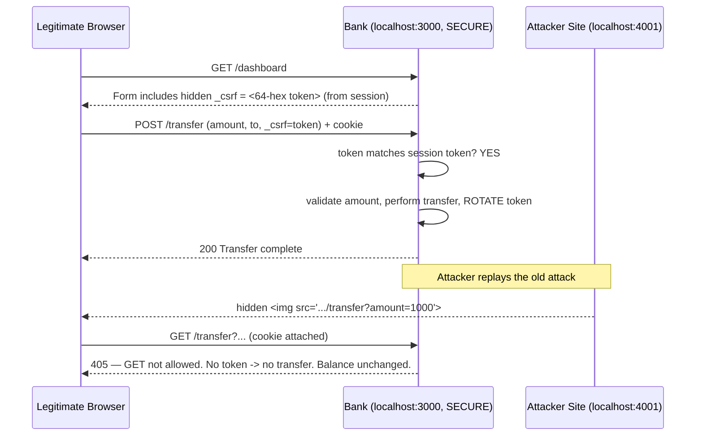

# Cross-Site Request Forgery (CSRF) — Exploitation and Mitigation

> **A local, educational mock-banking web application that demonstrates a GET-based CSRF vulnerability and its mitigation using the Synchronizer Token Pattern.**

---

## 1. Title and Academic Information

| Field | Value |
|---|---|
| **Project Title** | Web Server Security — Exploitation and Mitigation of CSRF (GET-based forged action) |
| **Institution** | Indian Institute of Information Technology, Allahabad |
| **Department** | Information Technology |
| **Course** | Cyber Security (IT-30001) |
| **Semester** | Autumn 2026 |
| **Vulnerability Category** | Cross-Site Request Forgery (CSRF) |
| **Assigned Variant** | GET-based forged action |
| **Deadline** | 03 November 2026 |
| **Student Name** | _`<YOUR NAME>`_ |
| **Roll Number** | _`<YOUR ROLL NUMBER>`_ |
| **Group Members** | _`<MEMBER 2 — Roll No.>`_, _`<MEMBER 3 — Roll No.>`_, _`<MEMBER 4 — Roll No.>`_ |

> Replace the placeholders above with your actual details before submission.

---

## 2. Abstract

This project is a self-contained, locally hosted demonstration of a **Cross-Site Request Forgery (CSRF)** attack and its defence. It implements a simulated banking application ("SafeBank") with session-based authentication and an initial balance of **₹5000**.

The application can run in two modes:

- **Vulnerable mode** exposes a state-changing money-transfer endpoint over `GET /transfer?amount=...`, protected by nothing more than the session cookie. A separate attacker website (on a different origin, port `4001`) silently triggers this endpoint from the victim's authenticated browser, transferring money without the victim's consent.
- **Secure mode** removes the GET endpoint, moves transfers to `POST /transfer`, and enforces a cryptographically strong **per-session CSRF token** (the Synchronizer Token Pattern). The same attack now fails, while legitimate transfers continue to work.

The project includes 12 automated tests (all passing), a working attacker page, inline security comments, and full documentation for a viva demonstration.

---

## 3. Problem Statement

Modern web applications authenticate users with **session cookies**. Once a user logs in, the browser stores a cookie and **automatically attaches it to every subsequent request to that site** — no matter who or what caused the request.

This convenience is also a weakness. If a state-changing action (transferring money, changing an email, deleting an account) can be triggered by a simple request, then a malicious website the user visits can **forge that request** from the user's browser. The browser dutifully attaches the valid session cookie, and the server — seeing a valid session — performs the action.

**Authentication alone is insufficient**, because a valid session cookie proves *who* the user is, but **not** that the user *intended* this particular action. CSRF exploits exactly this gap between identity and intent.

---

## 4. Learning Objectives

By completing this project, we demonstrate understanding of:

1. How browsers handle cookies and cross-origin requests.
2. Why state-changing `GET` requests are dangerous.
3. How a CSRF attack is constructed and delivered.
4. Why the Same-Origin Policy does **not** prevent CSRF.
5. How the Synchronizer Token Pattern defeats CSRF.
6. The role of `SameSite` cookies, `HttpOnly`, re-authentication, and HTTP method semantics.
7. The difference between CSRF, XSS, and authentication attacks.
8. Secure coding practices: server-side validation, token rotation, constant-time comparison.

---

## 5. CSRF Fundamentals

### What is CSRF?
CSRF (Cross-Site Request Forgery), also called a "one-click attack" or "session riding", tricks an authenticated user's browser into sending an unwanted request to a site where they are logged in. The request runs **with the victim's privileges**.

### How it works (step by step)
1. The victim logs into a trusted site (the bank). The browser stores a session cookie.
2. Without logging out, the victim visits a malicious site (or opens a crafted email/link).
3. The malicious page contains hidden HTML/JS that issues a request to the bank — e.g. an `` whose `src` is the bank's transfer URL.
4. The browser sends that request to the bank **and automatically attaches the bank's session cookie**.
5. The bank sees a valid session and performs the action, believing it came from the user.

### The roles
- **Victim** — a logged-in user with an active session cookie; the unwitting "signer" of the forged request.
- **Attacker** — controls a different website/email and crafts the forged request. They **cannot read** the victim's cookie or the bank's responses.
- **Vulnerable web application** — performs a state change based only on the cookie, with no proof of intent.
- **Browser cookies** — automatically attached to every request to a domain; this automatic attachment is the engine of the attack.

### The Same-Origin Policy (SOP) and why cross-origin requests still happen
The **Same-Origin Policy** stops a page on origin A from *reading* responses or data from origin B. It protects **confidentiality of responses**. However, SOP does **not** stop the browser from *sending* a request from A to B — browsers have always allowed cross-origin **sends** for ``, `<script>`, `<form>`, `<link>`, etc. (that is how the web embeds images and submits forms across sites).

CSRF needs only to **send** a request that causes a side effect; it does not need to **read** the response. So SOP, which blocks reading, provides no protection against a forged state-changing request.

### Why the server cannot simply trust the session cookie
The cookie is attached automatically and identically whether the request came from the real site or a forged one. The cookie answers *"who is this?"* but not *"did this user deliberately ask for this action from our site?"*. To close the gap, the server needs an **unforgeable secret that only our own pages can include** — that is the CSRF token.

### CSRF vs XSS vs authentication attacks
| Attack | What it exploits | Attacker needs | Key defence |
|---|---|---|---|
| **CSRF** | Automatic cookie attachment; trust in the cookie | A logged-in victim to visit a page | CSRF tokens, `SameSite`, POST + intent checks |
| **XSS** | The app rendering untrusted input as executable script | To inject script into the trusted page | Output encoding, CSP, input sanitisation |
| **Auth attack** (e.g. brute force, credential stuffing) | Weak credentials / session management | To guess/steal credentials | Strong passwords, MFA, rate limiting |

CSRF makes the victim's browser act; XSS runs attacker code *inside* the trusted site; auth attacks try to *become* the user. Note: if a site has XSS, CSRF defences can be bypassed — so they are complementary, not alternatives.

---

## 6. Technology Stack

| Technology | Why it was chosen |
|---|---|
| **Node.js (v18+)** | Ubiquitous JavaScript runtime; includes a built-in test runner (`node --test`), so no heavy test dependency is needed. |
| **Express.js** | Minimal, widely taught web framework; makes routes and middleware explicit and readable. |
| **express-session** | Industry-standard session middleware; stores a session id in a cookie — exactly the mechanism CSRF abuses. |
| **Node `crypto` module** | Generates cryptographically secure random CSRF tokens (`crypto.randomBytes`) and does constant-time comparison (`crypto.timingSafeEqual`). No third-party crypto needed. |
| **HTML + CSS + vanilla JS** | Keeps the front end transparent and beginner-friendly; no build step or framework to obscure what is happening. |
| **Node built-in test runner** | Zero-dependency automated tests that actually start the server and exercise it over HTTP. |

---

## 7. Prerequisites

- **Ubuntu** (any recent LTS) or any Linux/macOS/WSL environment.
- **Node.js** v18 or newer (v22 recommended — this project was tested on v22).
- **npm** v9 or newer (ships with Node).
- A modern web browser (Firefox or Chrome).

Check versions:

```bash
node --version   # should print v18.x or higher
npm --version    # should print 9.x or higher
```

---

## 8. Installation and Setup — Step by Step (Ubuntu)

### 8.1 Install Node.js and npm (if not already installed)

```bash
# Option A: Ubuntu's package manager (simple)
sudo apt update
sudo apt install -y nodejs npm

# Option B (recommended for a current version): NodeSource
curl -fsSL https://deb.nodesource.com/setup_22.x | sudo -E bash -
sudo apt install -y nodejs
```

Verify:

```bash
node --version
npm --version
```

### 8.2 Get the project

```bash
# If you received a zip, unzip it, then:
cd csrf-assignment

# Or if using git:
git clone <your-repo-url> csrf-assignment
cd csrf-assignment
```

### 8.3 Install dependencies

```bash
npm install
```

This installs `express` and `express-session` into `node_modules/`.

### 8.4 Run the automated tests (optional but recommended)

```bash
npm test
```

You should see `# pass 12  # fail 0`.

### 8.5 Start the servers

You need **two terminals**.

**Terminal 1 — the bank** (choose a mode):

```bash
# Vulnerable mode (for the attack demo)
npm run start:vulnerable
# -> Mock Bank running at http://localhost:3000  (VULNERABLE MODE)
```

**Terminal 2 — the attacker site:**

```bash
npm run attacker
# -> Attacker site at http://localhost:4001
```

### 8.6 Open the correct URLs

| URL | What it is |
|---|---|
| http://localhost:3000/login | The bank login page |
| http://localhost:3000/dashboard | The bank dashboard (after login) |
| http://localhost:4001/ | The attacker's "gift" page |

### 8.7 Switch to secure mode later

Stop the bank (`Ctrl+C` in Terminal 1) and restart in secure mode:

```bash
npm run start:secure
# -> SECURE MODE — POST /transfer protected by synchronizer CSRF token
```

### 8.8 Troubleshooting

| Problem | Fix |
|---|---|
| `EADDRINUSE: port 3000 already in use` | Another process holds the port. Find and stop it: `lsof -i :3000` then `kill <pid>`, or run with a different port: `PORT=3100 npm run start:vulnerable`. |
| `command not found: node` | Node is not installed or not on `PATH`. Re-do step 8.1. |
| `Cannot find module 'express'` | You skipped `npm install`. Run it in the project folder. |
| Attack doesn't change the balance | Make sure the **bank is in vulnerable mode** and you are **logged in** in the **same browser** you open the attacker page in. |
| Browser blocks the request | Some browsers' tracking protection can block cross-site cookies. Use a normal (non-incognito) window, or Firefox with standard protection; `SameSite` behaviour is discussed in §16. |

---

## 9. Project Structure

```
csrf-assignment/
├── server.js                # Mock bank. MODE=vulnerable | secure. Contains BOTH implementations.
├── attacker.js              # Separate Express server (port 4001) serving the attacker page.
├── package.json             # Scripts + dependencies.
├── package-lock.json        # Locked dependency versions (reproducible installs).
├── .gitignore               # Ignores node_modules, logs, .env, etc.
├── README.md                # This file.
├── attacker/
│   └── attacker.html        # The malicious "Claim Your Gift" page (forged GET payload).
├── public/
│   └── styles.css           # Shared stylesheet for the bank pages.
├── views/
│   ├── login.html           # Login form (POST /login).
│   ├── dashboard.html       # Balance + transfer form (GET in vuln mode, POST+token in secure mode).
│   └── result.html          # Transfer result / blocked-attack page.
├── docs/
│   ├── VIVA.md              # 30+ Q&A, follow-ups, quick revision sheet.
│   ├── VIDEO_SCRIPT.md      # 2–3 min narrated demo script.
│   ├── TECHNICAL_EXPLANATION.md  # Deep dive on browser/cookie/CSRF mechanics.
│   └── MITIGATION_COMPARISON.md  # Token vs SameSite vs re-auth vs method change.
├── test/
│   └── csrf.test.js         # 12 automated tests (node --test).
└── screenshots/
    └── .gitkeep             # Put your captured evidence PNGs here.
```

### Key file responsibilities
- **`server.js`** — The entire bank. A single `MODE` environment variable selects which transfer endpoint is mounted, so the vulnerable and secure code sit side by side and the difference is unambiguous. Also exports `createApp(mode)` so the tests can spin up either version.
- **`attacker.js` + `attacker/attacker.html`** — The attacker, on a deliberately different origin (port 4001). The HTML carries the forged `GET` payload.
- **`test/csrf.test.js`** — Starts real servers on ephemeral ports and drives them over HTTP with a cookie jar, proving both the exploit and the fix.

---

## 10. Application Architecture

### Vulnerable flow (CSRF succeeds)

```mermaid
sequenceDiagram
    participant V as Victim's Browser
    participant B as Bank (localhost:3000, VULNERABLE)
    participant A as Attacker Site (localhost:4001)

    V->>B: POST /login
    B-->>V: Set-Cookie: session=... (stored by browser)
    Note over V,B: Victim is now authenticated

    V->>A: Victim visits attacker "gift" page
    A-->>V: HTML with hidden 
    Note over V: Browser auto-loads the "image"
    V->>B: GET /transfer?amount=1000&to=attacker  (cookie attached automatically!)
    B->>B: Valid session -> transfer ₹1000
    B-->>V: (response discarded by browser; attacker never needs it)
    Note over B: Balance 5000 -> 4000 without victim's consent
```

### Mitigated flow (CSRF fails, legitimate transfer works)



---

## 11. Vulnerable Implementation

- **Vulnerable endpoint:** `GET /transfer?amount=<n>&to=<name>`
- **HTTP method:** `GET` (a method that must never change server state).
- **Protection:** only the session cookie — **no CSRF token, no intent check**.

The exact code responsible (from [`server.js`](server.js)):

```js
// !!! INTENTIONALLY VULNERABLE CODE — DO NOT COPY INTO REAL SOFTWARE !!!
app.get('/transfer', requireLogin, (req, res) => {
  const check = validateAmount(req.query.amount, req.session.balance);
  if (!check.ok) {
    return respondTransfer(req, res, { success: false, message: check.error });
  }
  const to = (req.query.to || 'attacker-account').toString().slice(0, 40);

  // State change via GET + cookie only == exploitable by CSRF.
  req.session.balance -= check.amount;

  return respondTransfer(req, res, {
    success: true,
    message: `₹${check.amount} transferred to "${to}".`,
    amount: check.amount, to,
  });
});
```

### Why it is vulnerable / root cause
- The action **changes state** (moves money) in response to a **`GET`** request, which can be triggered by an ``, `<script>`, link, or auto-submitting form from **any** website.
- The only check is `requireLogin`, i.e. *"is there a valid session cookie?"*. The browser attaches that cookie automatically to the forged cross-origin request.
- **Incorrect security assumption:** *"a valid session cookie means the user intended this request."* Cookie presence proves **identity**, not **intent**. There is nothing in the request that only our own pages could have produced.

---

## 12. Exploitation Guide

> You need the **bank in vulnerable mode** (Terminal 1) and the **attacker server** (Terminal 2) running — see §8.5.

1. **Start the vulnerable bank:** `npm run start:vulnerable` → http://localhost:3000
2. **Log in:** open http://localhost:3000/login, click **Log in** (any credentials). You land on the dashboard. *(Screenshot: `screenshots/01-initial-balance.png`)*
3. **Verify the initial balance:** it reads **₹5000**.
4. **Open the attacker website:** in the **same browser**, go to http://localhost:4001/. *(Screenshot: `screenshots/03-attacker-page.png`)*
5. **Trigger the attack:** the hidden `` fires automatically on page load (no click needed). Optionally click **"Claim Your Gift"** to fire the backup form payload too.
6. **Verify the unauthorized transfer:** return to http://localhost:3000/dashboard.
7. **Verify the final balance:** it is now **₹4000** — ₹1000 left without your consent. *(Screenshot: `screenshots/05-balance-after-attack.png`)*

### The exact request and payload
The attacker page contains:

```html

```

When the browser tries to load this "image", it issues:

```
GET /transfer?amount=1000&to=attacker HTTP/1.1
Host: localhost:3000
Cookie: connect.sid=s%3A...     <-- attached automatically by the browser
```

### Capturing evidence
Open your browser's **DevTools → Network** tab before visiting the attacker page. You will see the cross-origin request to `localhost:3000/transfer` with the cookie attached and a successful status. Screenshot it alongside the before/after balances.

---

## 13. Exploit Explanation

- **Why the browser attaches the session cookie:** cookies are bound to a *domain*, not to the page that caused the request. Any request to `localhost:3000` — even one initiated by `localhost:4001` — carries `localhost:3000`'s cookies automatically. This is standard, long-standing browser behaviour.
- **Why the request succeeds:** the vulnerable server authorises purely on the presence of a valid session. The forged request has one, so the server treats it as genuine and performs the transfer.
- **Why the attacker does not need to read the response:** the goal is the **side effect** (money moved), not information. The Same-Origin Policy prevents the attacker's page from reading the bank's response, but that does not matter — the damage is already done server-side. CSRF is a **write/action** attack, not a **read** attack.

---

## 14. Mitigation Implemented

### Why GET should not change server state
Per HTTP semantics (RFC 9110), `GET` is **safe** and **idempotent** — it should only *retrieve* data and never cause side effects. Browsers, proxies, and crawlers freely prefetch and repeat GETs, and GET URLs can be embedded anywhere (``, links). Any state change behind a GET is trivially forgeable and cacheable.

### Why POST is used for state-changing operations
`POST` is not cacheable or prefetched, cannot be triggered by an ``, and (combined with `SameSite`/CORS rules) is harder to forge. **But POST alone is not a CSRF defence** — an attacker can auto-submit a hidden cross-origin `<form method="POST">`. POST is a *prerequisite* that we combine with a token.

### How the Synchronizer Token Pattern works
1. **Generate** a cryptographically strong token at login:
   ```js
   req.session.csrfToken = crypto.randomBytes(32).toString('hex'); // 64 hex chars
   ```
2. **Store** it in the **server-side session** (never derivable by an attacker).
3. **Embed** it in every legitimate transfer form as a hidden field:
   ```html
   <input type="hidden" name="_csrf" value="{{CSRF_TOKEN}}" />
   ```
   A cross-origin attacker **cannot read** this value (the Same-Origin Policy blocks them from reading our page or session), so they cannot include a correct token.
4. **Validate** on every state-changing request, using a constant-time comparison:
   ```js
   app.post('/transfer', requireLogin, (req, res) => {
     const submitted = req.body._csrf || '';
     const expected  = req.session.csrfToken || '';
     if (!expected || !csrfTokenMatches(submitted, expected)) {
       return respondTransfer(req, res,
         { success: false, message: 'Invalid or missing CSRF token. Request rejected.' }, 403);
     }
     // ... validate amount, perform transfer ...
     req.session.csrfToken = crypto.randomBytes(32).toString('hex'); // rotate
   });
   ```
   ```js
   function csrfTokenMatches(submitted, expected) {
     const a = Buffer.from(String(submitted));
     const b = Buffer.from(String(expected));
     if (a.length !== b.length) return false;
     return crypto.timingSafeEqual(a, b); // avoids timing side channels
   }
   ```
5. **Missing or invalid token → `403 Forbidden`**, no state change.
6. The legacy `GET /transfer` route is **removed** from state-changing logic; in secure mode it only returns **`405 Method Not Allowed`**.
7. The token is **rotated** after each successful transfer, so a leaked token cannot be replayed.

---

## 15. Mitigation Verification

> Restart the bank in **secure mode**: `npm run start:secure`.

1. **Repeat the original exploit:** log in at http://localhost:3000/login, then open http://localhost:4001/ in the same browser.
2. **Verify it fails:** the forged `GET /transfer?...` now returns **`405 Method Not Allowed`** and performs no transfer. *(Screenshot: `screenshots/06-blocked-exploit.png`)*
3. **Verify the balance is unchanged:** the dashboard still reads **₹5000**.
4. **Execute a legitimate transfer:** on the dashboard, use the transfer form (now a **POST** with a hidden token), enter an amount, and submit.
5. **Verify success:** the transfer completes and the balance decreases (e.g. ₹5000 → ₹4500). *(Screenshot: `screenshots/07-legit-secure-transfer.png`)*

You can also prove it on the command line (works because the token lives in the session):

```bash
# No token -> 403
curl -s -c jar -b jar -d "username=demo&password=x" http://localhost:3000/login -o /dev/null
curl -s -b jar -H "Accept: application/json" -d "amount=500&to=x" http://localhost:3000/transfer
# -> {"success":false,"message":"Invalid or missing CSRF token. Request rejected.", ...} (403)

# Forged GET replay -> 405, balance untouched
curl -s -b jar -o /dev/null -w "%{http_code}\n" "http://localhost:3000/transfer?amount=1000&to=attacker"
# -> 405
```

---

## 16. Other Mitigation Alternatives (Theory)

### SameSite cookies
Setting `Set-Cookie: ...; SameSite=Lax` (or `Strict`) tells the browser **not to send the cookie on cross-site requests** (Strict), or only on top-level navigations (Lax).
- **Strength:** simple, browser-enforced, no application code per form; `Lax` is now the browser default and blocks most CSRF including cross-site ``/`<form>` sends.
- **Limitations:** relies on browser support and correct configuration; `Lax` still allows top-level GET navigations (so a state-changing GET link can slip through); subtle edge cases with sub-domains; not a substitute for tokens in high-assurance flows. **Best used as defence-in-depth alongside tokens.**

### Re-authentication / step-up for sensitive actions
Require the user to re-enter their password (or a 2FA/OTP) immediately before a sensitive action.
- **Strength:** strong proof of intent; the attacker cannot supply the fresh credential.
- **Limitations:** adds friction; impractical for frequent actions; still best combined with tokens.

### Avoiding state-changing GET requests
Make all state changes use `POST`/`PUT`/`DELETE` and keep `GET` strictly read-only.
- **Strength:** removes the easiest CSRF vector (image/link-triggered side effects) and follows correct HTTP semantics.
- **Limitations:** POST forms can still be auto-submitted cross-site, so this is **necessary but not sufficient** — it must be paired with a token or `SameSite`.

**This project uses the Synchronizer Token Pattern (primary) + POST-only state changes, and discusses `SameSite` as complementary defence-in-depth.**

---

## 17. Security Analysis

### Threat model
- **Attacker capability:** can get the victim to visit an attacker-controlled page (phishing link, ad, forum post). Cannot read the victim's cookies or the bank's responses; cannot run script on the bank's origin (that would be XSS, a different class).
- **Asset:** the victim's account balance / ability to transfer funds.
- **Goal:** cause an unauthorized state change using the victim's session.

### Security assumptions
- The victim has an active, authenticated session in the same browser.
- The bank has no XSS vulnerability (if it did, CSRF tokens could be read and the defence bypassed).
- The CSRF token source is cryptographically secure (`crypto.randomBytes`).

### Limitations of the demonstration
- Balance is stored **in the session** for simplicity (no database); each browser session has its own balance.
- Login accepts any credentials because authentication strength is out of scope.
- Everything runs over **plain HTTP on localhost**. In production you would serve over **HTTPS** and set `cookie.secure = true` and `SameSite`.

### Why local HTTP is used
This is a teaching sandbox; setting up TLS certificates would add noise without changing the CSRF lesson. The code comments mark exactly what must change for production (`secure: true`, `SameSite`, HSTS).

### Why secure cookie settings matter in production
Over HTTP, cookies can be read by a network attacker (sniffing). `Secure` forces cookies to travel only over HTTPS; `HttpOnly` blocks JS from reading them (mitigates XSS cookie theft); `SameSite` reduces cross-site sending (CSRF defence-in-depth).

### Defence-in-depth
No single control is relied upon: **POST-only** + **synchronizer token** + (recommended) **`SameSite`** + (for the most sensitive actions) **re-authentication**. Layers mean one failing control does not expose the asset.

---

## 18. Testing

Run `npm test`. All tests were executed on **Node v22** and **pass**.

| # | Test case | Expected | Actual |
|---|---|---|---|
| 1 | `validateAmount` rejects zero/negative/non-numeric/excessive/non-integer | Reject all; accept 500 | ✅ Pass |
| 2 | Vulnerable: login works; initial balance ₹5000 | Balance = 5000 | ✅ Pass |
| 3 | Vulnerable: `GET /transfer` succeeds, balance decreases | 5000 → 4500 | ✅ Pass |
| 4 | Vulnerable: forged GET attack transfers money (CSRF) | 5000 → 4000 | ✅ Pass |
| 5 | Vulnerable: unauthenticated transfer rejected | 401 | ✅ Pass |
| 6 | Vulnerable: invalid/zero/negative/excessive amounts rejected; balance intact | All rejected, 5000 | ✅ Pass |
| 7 | Secure: legitimate POST with valid token succeeds | 5000 → 4500 | ✅ Pass |
| 8 | Secure: POST with **no** token rejected; balance intact | 403, 5000 | ✅ Pass |
| 9 | Secure: POST with **invalid** token rejected | 403, 5000 | ✅ Pass |
| 10 | Secure: same GET-based attack fails; balance unchanged | 405, 5000 | ✅ Pass |
| 11 | Secure: token rotates after success (replay rejected) | 403 on replay | ✅ Pass |
| 12 | Secure: invalid amount rejected even with valid token | 400, 5000 | ✅ Pass |

```
# tests 12
# pass 12
# fail 0
```

> Cases 11 & 12 cover the assignment's "balance unchanged after blocked attack" and "legitimate secure transfers work" requirements, plus token rotation as a bonus hardening.

---

## 19. Evidence and Screenshots

Capture each of these and place the PNG in `screenshots/`. **Do not fabricate — take real screenshots during your demo.**

| # | Screenshot file | What it should show | When to capture |
|---|---|---|---|
| 1 | `screenshots/01-initial-balance.png` | Dashboard, **VULNERABLE** badge, balance ₹5000 | After first login in vulnerable mode |
| 2 | `screenshots/02-vulnerable-code.png` | `server.js` GET `/transfer` block (the vulnerable code) | From your editor |
| 3 | `screenshots/03-attacker-page.png` | The attacker "Claim Your Gift" page at :4001 | Before triggering |
| 4 | `screenshots/04-successful-exploit.png` | DevTools Network tab showing the cross-origin GET to :3000/transfer with cookie | At trigger time |
| 5 | `screenshots/05-balance-after-attack.png` | Dashboard now showing ₹4000 | After the attack |
| 6 | `screenshots/06-blocked-exploit.png` | Secure mode: 405 / unchanged ₹5000 after replaying the attack | In secure mode |
| 7 | `screenshots/07-legit-secure-transfer.png` | Secure mode: successful POST transfer, balance decreased | In secure mode |

---

## 20. Video Demonstration Guide

Target: **2–3 minutes**. (A full narrated script is in [`docs/VIDEO_SCRIPT.md`](docs/VIDEO_SCRIPT.md).)

1. **(0:00–0:20)** Show the bank in vulnerable mode; log in; point out balance ₹5000 and the "VULNERABLE MODE" badge.
2. **(0:20–0:40)** Open `server.js`; point to the `GET /transfer` block and its root-cause comment.
3. **(0:40–1:10)** Open the attacker page at :4001; explain the hidden ``; show the balance drop to ₹4000. Show DevTools Network with the forged request + cookie.
4. **(1:10–1:30)** Stop the bank; restart in **secure mode**; re-login.
5. **(1:30–2:10)** Replay the attacker page → 405/no change. Show the secure code: token generation, POST handler, validation, rotation.
6. **(2:10–2:40)** Do a legitimate POST transfer in secure mode → succeeds. Balance decreases.
7. **(2:40–3:00)** Summarise: identity ≠ intent; token proves intent; POST + token + SameSite = defence-in-depth.

---

## 21. Ownership Declaration

| Member name | Roll number | Category | Variant implemented |
|---|---|---|---|
| _`<YOUR NAME>`_ | _`<ROLL NO.>`_ | Cross-Site Request Forgery (CSRF) | GET-based forged action |
| _`<MEMBER 2>`_ | _`<ROLL NO.>`_ | _`<their category>`_ | _`<their variant>`_ |
| _`<MEMBER 3>`_ | _`<ROLL NO.>`_ | _`<their category>`_ | _`<their variant>`_ |
| _`<MEMBER 4>`_ | _`<ROLL NO.>`_ | _`<their category>`_ | _`<their variant>`_ |

> Fill in your group's real details. Keep your own row (CSRF / GET-based forged action) as implemented here.

---

## 22. Viva Preparation (25+ Q&A)

A larger set (30+ with follow-ups and a last-10-minutes revision sheet) is in [`docs/VIVA.md`](docs/VIVA.md).

1. **What is CSRF?** An attack that makes an authenticated user's browser send an unwanted, state-changing request to a site they're logged into, using the automatically attached session cookie.
2. **Why isn't authentication enough to stop CSRF?** A cookie proves identity, not intent. The forged request carries the same valid cookie, so the server can't tell it wasn't user-initiated.
3. **Why is a state-changing GET especially dangerous?** GET requests can be triggered by ``, links, and prefetching from any site, with no user action, making them trivially forgeable.
4. **Does the Same-Origin Policy stop CSRF?** No. SOP blocks *reading* cross-origin responses, but browsers still *send* cross-origin requests (images, forms). CSRF only needs the send/side effect.
5. **Why doesn't the attacker need to read the response?** CSRF is a write/action attack; the damage is the server-side state change, not information disclosure.
6. **How does the browser decide to attach the cookie?** Cookies are keyed to a domain; any request to that domain carries its cookies automatically, regardless of which page initiated it.
7. **What is the Synchronizer Token Pattern?** The server stores a random secret in the session and embeds it in forms; each state-changing request must echo it back. A cross-origin attacker can't read it, so can't forge a valid request.
8. **Where is the token stored, and why there?** In the server-side session. The attacker can't read the server session or our rendered page (SOP), so the token stays secret.
9. **How is the token generated?** `crypto.randomBytes(32).toString('hex')` — 256 bits of CSPRNG output, 64 hex chars.
10. **Why `crypto.timingSafeEqual` for comparison?** To prevent timing side-channel attacks that could leak the token one character at a time via response-time differences.
11. **What happens on a missing/invalid token?** The server responds `403 Forbidden` and performs no state change.
12. **Why switch from GET to POST?** To follow HTTP semantics (GET must be side-effect-free) and remove the easiest forgery vector. POST can't be fired by an ``.
13. **Is POST alone enough?** No. A hidden cross-site `<form method="POST">` can auto-submit. POST must be combined with a token (or SameSite).
14. **What does `SameSite` do?** It tells the browser not to send the cookie on cross-site requests (`Strict`) or only on top-level navigations (`Lax`), reducing CSRF.
15. **What does `HttpOnly` do, and does it stop CSRF?** It blocks JavaScript from reading the cookie (mitigates XSS cookie theft). It does **not** stop CSRF, because the browser still *sends* the cookie.
16. **Difference between CSRF and XSS?** CSRF forges requests using the victim's session from another site; XSS runs attacker script inside the trusted site. XSS can defeat CSRF tokens.
17. **Why rotate the token after a transfer?** So a token that leaked (e.g. via logs or history) can't be replayed for a second action.
18. **What is the root cause in our vulnerable code?** State change on `GET` authorised solely by the session cookie — trusting identity as if it were intent.
19. **Why is the attacker on port 4001?** A different port = a different origin, creating the cross-site condition CSRF requires.
20. **Could the attack work via email instead of a web page?** Yes — an HTML email with a remote `` pointing at the GET endpoint can trigger it when the email is opened in a logged-in browser context.
21. **What status code does the secured app return to the forged GET?** `405 Method Not Allowed` (and no transfer).
22. **How do your automated tests simulate the browser's cookie behaviour?** A small cookie jar stores the `Set-Cookie` from login and resends it, exactly like a browser attaching the session cookie.
23. **What server-side validation do you perform on the amount?** It must be a positive **integer**, not NaN/empty, and not exceed the balance; checks run on both modes regardless of client-side limits.
24. **Why validate on the server when the form has `min="1"`?** Client-side checks are advisory and bypassable; the attacker (or curl) never uses your form. The server is the only trustworthy boundary.
25. **If you could add one more defence, what would it be?** `SameSite=Lax/Strict` on the session cookie (plus HTTPS with `Secure`) as defence-in-depth — and re-authentication for high-value transfers.

---

## 23. Conclusion

This project demonstrated, end to end, how a seemingly harmless design choice — changing state with an authenticated `GET` request — opens a serious **CSRF** vulnerability, and how an attacker on a different origin can silently drain an account using nothing but the victim's own browser and session cookie. We then implemented a genuine mitigation: moving to `POST`, enforcing a cryptographically secure **synchronizer CSRF token** bound to the session, validating it in constant time, rotating it after use, and removing the vulnerable GET endpoint. The same attack that drained ₹1000 in vulnerable mode is fully blocked in secure mode, while legitimate transfers continue to succeed — all verified by 12 passing automated tests and a live browser demonstration. The core lesson: **identity is not intent**, and defence-in-depth (correct HTTP methods + tokens + `SameSite` + HTTPS) is what keeps state-changing operations safe.

---

## 24. References

- [OWASP — Cross-Site Request Forgery (CSRF)](https://owasp.org/www-community/attacks/csrf)
- [OWASP — CSRF Prevention Cheat Sheet](https://cheatsheetseries.owasp.org/cheatsheets/Cross-Site_Request_Forgery_Prevention_Cheat_Sheet.html)
- [MDN — HTTP request methods](https://developer.mozilla.org/en-US/docs/Web/HTTP/Methods)
- [MDN — SameSite cookies](https://developer.mozilla.org/en-US/docs/Web/HTTP/Headers/Set-Cookie/SameSite)
- [MDN — Same-origin policy](https://developer.mozilla.org/en-US/docs/Web/Security/Same-origin_policy)
- [Express documentation](https://expressjs.com/)
- [express-session documentation](https://github.com/expressjs/session#readme)
- [Node.js crypto — randomBytes](https://nodejs.org/api/crypto.html#cryptorandombytessize-callback)
- [Node.js crypto — timingSafeEqual](https://nodejs.org/api/crypto.html#cryptotimingsafeequala-b)
- [RFC 9110 — HTTP Semantics (safe/idempotent methods)](https://www.rfc-editor.org/rfc/rfc9110#name-safe-methods)

---

### License
MIT — for educational use. This software intentionally contains a vulnerability in "vulnerable mode"; **never deploy it** or expose it to a public network.
